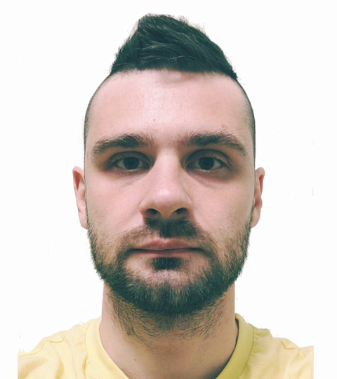
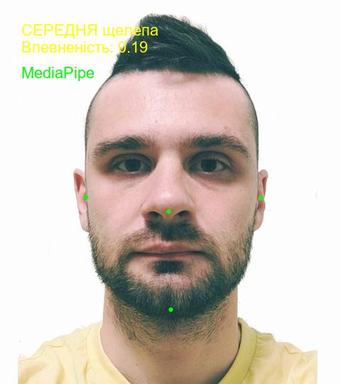
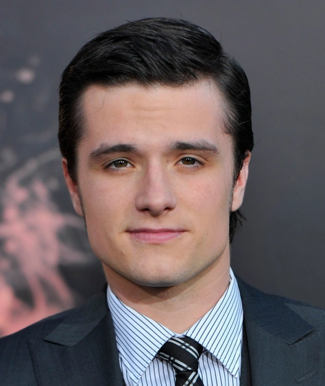
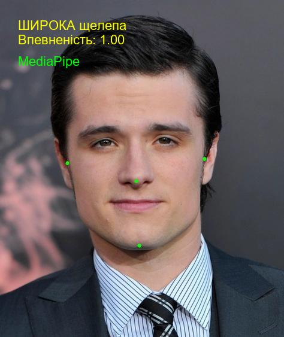

<h1>🧠 Класифікація ширини нижньої щелепи</h1>

	Ця програма класифікує тип нижньої щелепи як <code>вузька</code>,
	<code>середня</code> або <code>широка</code> на основі фронтального фото
	обличчя з використанням <strong>MediaPipe FaceMesh</strong>.

<h2>📐 Використана метрика</h2>

	Ми використовуємо метрику <strong>face-width / lower-face-height</strong>, яка
	використовується у науковій літературі як надійний індикатор, зокрема в роботі
	Lefevre et al. (2013).

<pre><code>JawRatio = FaceWidth / LowerFaceHeight</code></pre>

<h2>🔹 Позначення</h2>

<ul>
	<li>
		<strong>Face Width (W)</strong> — відстань між лівим та правим краєм нижньої
		щелепи (landmarks 234 ↔ 454)
	</li>
	<li>
		<strong>Lower Face Height (H)</strong> — відстань від центру лоба (landmark
		1) до підборіддя (landmark 152)
	</li>
</ul>

<h2>📏 Формула</h2>

<pre><code>
width = || landmarks[234] - landmarks[454] ||
height = || landmarks[1] - landmarks[152] ||
ratio = width / height
</code></pre>

<h2>🧪 Класифікація</h2>

На основі значення <code>ratio</code> ми класифікуємо ширину щелепи так:

<table>
	<thead>
		<tr>
			<th>Клас</th>
			<th>Умова (JawRatio)</th>
			<th>Опис</th>
		</tr>
	</thead>
	<tbody>
		<tr>
			<td>вузька</td>
			<td>&lt; 1.6</td>
			<td>Вузьке, витягнуте обличчя</td>
		</tr>
		<tr>
			<td>середня</td>
			<td>1.6 – 1.8</td>
			<td>Середнє співвідношення</td>
		</tr>
		<tr>
			<td>широка</td>
			<td>&gt; 1.8</td>
			<td>Широка нижня щелепа</td>
		</tr>
	</tbody>
</table>

<h2>📊 Впевненість (confidence)</h2>

Визначається як відстань від межі класу, нормалізована до [0.0 – 1.0]:

<ul>
	<li>вузька: <code>(1.6 - ratio) / 0.2</code></li>
	<li>широка: <code>(ratio - 1.8) / 0.2</code></li>
	<li>середня: <code>1 - abs(ratio - 1.7) / 0.1</code></li>
</ul>

<h2>📥 Використані FaceMesh точки</h2>

<table>
	<thead>
		<tr>
			<th>Landmark</th>
			<th>Назва</th>
			<th>Призначення</th>
		</tr>
	</thead>
	<tbody>
		<tr>
			<td>234</td>
			<td>Left jaw</td>
			<td>Лівий край щелепи</td>
		</tr>
		<tr>
			<td>454</td>
			<td>Right jaw</td>
			<td>Правий край щелепи</td>
		</tr>
		<tr>
			<td>1</td>
			<td>Glabella</td>
			<td>Між очима (верх обличчя)</td>
		</tr>
		<tr>
			<td>152</td>
			<td>Chin</td>
			<td>Центр підборіддя</td>
		</tr>
	</tbody>
</table>

<h2>🖼 Приклади</h2>

<table>
	<thead>
		<tr>
			<th>Тип</th>
			<th>До</th>
			<th>Після</th>
		</tr>
	</thead>
	<tbody>
		<tr>
			<td>Вузька</td>
			<td></td>
			<td></td>
		</tr>
		<tr>
			<td>Середня</td>
			<td></td>
			<td></td>
		</tr>
		<tr>
			<td>Широка</td>
			<td></td>
			<td></td>
		</tr>
	</tbody>
</table>

<h2>🧬 Наукове обґрунтування</h2>

Наукова публікація:

<blockquote>
	Lefevre, C. E., Lewis, G. J., Perrett, D. I., &amp; Penke, L. (2013). 
	<em
		>Telling facial metrics: facial width is associated with testosterone levels
		in men.</em
	> 
	Evolution and Human Behavior. 
	<a href="https://doi.org/10.1016/j.evolhumbehav.2013.03.005">читати статтю</a>
</blockquote>

<h2>▶️ Запуск через Poetry</h2>

<ol>
	<li>
		Встанови Poetry:
		<pre><code>pip install poetry</code></pre>
	</li>
	<li>
		Вибери версію Python:
		<pre><code>poetry env use /шлях/до/python3.10.11</code></pre>
		
Якщо Python 3.10.11 не встановлено:

		<pre><code>poetry python install 3.10.11</code></pre>
		
Отримати список доступних інтерпретаторів та їх шлях:

		<pre><code>poetry python list -m</code></pre>
	</li>
	<li>
		Встанови залежності:
		<pre><code>poetry install</code></pre>
	</li>
	<li>
		Запусти Streamlit-вебдемо:
		<pre><code>poetry run streamlit run app.py</code></pre>
	</li>
</ol>
